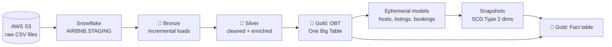

<div align="center">

# 🏠 StayScope

### Airbnb analytics on Snowflake, modeled end to end with dbt

Raw listings, hosts and bookings land in **AWS S3**, load into **Snowflake**, and move through a **bronze → silver → gold** dbt project into analytics-ready tables with full change history.


</div>

---

## 📌 Overview

StayScope takes three raw Airbnb datasets (**listings**, **hosts** and **bookings**) and turns them into a clean analytics layer that a dashboard or analyst can query directly.

The project focuses on the things that matter in a real warehouse: loading only what changed, keeping historical versions of dimensions, generating repetitive SQL with Jinja instead of copy-paste, and testing the data before anyone trusts it.

## 🏗️ Architecture



## 🧱 Layers

| Layer | Schema | What happens there |
|---|---|---|
| **Staging** | `AIRBNB.STAGING` | Raw tables loaded from S3, declared as dbt `sources` |
| **Bronze** | `AIRBNB.BRONZE` | Incremental models that only pull rows newer than the latest `CREATED_AT` |
| **Silver** | `AIRBNB.SILVER` | Incremental merge on business keys, derived columns through reusable macros |
| **Gold** | `AIRBNB.GOLD` | One Big Table, SCD Type 2 dimensions from snapshots, and a fact table |

## ✨ Highlights

- **Incremental loading.** Bronze models use `is_incremental()` to read only new records, and silver models merge on a `unique_key` so reruns stay idempotent.
- **Config-driven SQL with Jinja.** The One Big Table and fact model are generated from a list of table configs (table, columns, alias, join condition) and a Jinja loop, so adding a table means adding one entry, not rewriting joins.
- **Reusable macros.** `multiply()` for rounded calculations, `tag()` to bucket prices into low / medium / high, `trimmer()` for text cleanup, and a custom `generate_schema_name()` that routes each layer to its own schema.
- **History with SCD Type 2.** Ephemeral models feed dbt **snapshots** (timestamp strategy) that build `DIM_HOSTS`, `DIM_LISTINGS` and `DIM_BOOKINGS` with `dbt_valid_from` / `dbt_valid_to`, using `9999-12-31` for current rows.
- **Data quality.** Singular tests run against the sources, with severity set to `warn` for business rules that should alert without blocking the pipeline.

## 📁 Project structure

```
.
├── ourProject_awsDBTsnow/
│   ├── models/
│   │   ├── sources/        # staging sources (S3 → Snowflake)
│   │   ├── bronze/         # incremental raw copies
│   │   ├── silver/         # cleaned + enriched, merged on keys
│   │   └── gold/
│   │       ├── obt.sql     # One Big Table (Jinja config loop)
│   │       ├── fact.sql    # fact table joined to SCD2 dims
│   │       └── ephemeral/  # inputs for the snapshots
│   ├── snapshots/          # SCD Type 2 dimensions
│   ├── macros/             # multiply, tag, trimmer, schema routing
│   ├── tests/              # singular data tests
│   ├── analyses/           # exploration + Jinja practice
│   └── dbt_project.yml
├── pyproject.toml          # managed with uv
└── uv.lock
```

## 🚀 Run it locally

**Prerequisites:** Python 3.12, [uv](https://docs.astral.sh/uv/), a Snowflake account, and the raw files loaded into `AIRBNB.STAGING`.

1. Install dependencies

   ```bash
   uv sync
   ```

2. Create `~/.dbt/profiles.yml` (never commit this file)

   ```yaml
   ourProject_awsDBTsnow:
     target: dev
     outputs:
       dev:
         type: snowflake
         account: <your_account_identifier>
         user: <your_user>
         password: "{{ env_var('SNOWFLAKE_PASSWORD') }}"
         role: ACCOUNTADMIN
         warehouse: COMPUTE_WH
         database: AIRBNB
         schema: STAGING
         threads: 4
   ```

3. Build the project in dependency order

   ```bash
   cd ourProject_awsDBTsnow
   dbt debug                          # check the connection
   dbt run  --select bronze silver obt
   dbt snapshot                       # SCD Type 2 dimensions
   dbt run  --select fact
   dbt test
   ```

4. Explore the lineage graph

   ```bash
   dbt docs generate && dbt docs serve
   ```

## 🧠 What I learned

- Designing a medallion layout inside a warehouse, with each layer in its own schema.
- When to use `table`, `incremental` and `ephemeral` materializations, and why `unique_key` matters for safe reruns.
- Writing Jinja that generates SQL from configuration instead of repeating it.
- Using snapshots to keep a full change history of dimensions (SCD Type 2).

## 🔭 Next steps

- [ ] Replace hard-coded table names in `obt.sql` and `fact.sql` with `ref()` so dbt tracks the full lineage.
- [ ] Add generic tests (`unique`, `not_null`, `relationships`) in schema YAML files.
- [ ] Orchestrate the run with Airflow or a scheduled job.

---

<div align="center">

**Mohammed Alharbi** · Data Engineer

[Portfolio](https://devmohammedalharbi.github.io) · [LinkedIn](https://linkedin.com/in/mohammed-alharbi-1606a7388) · [GitHub](https://github.com/DevMohammedAlharbi)

</div>
